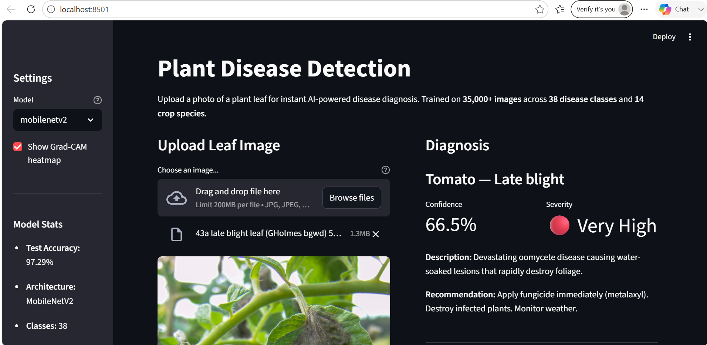
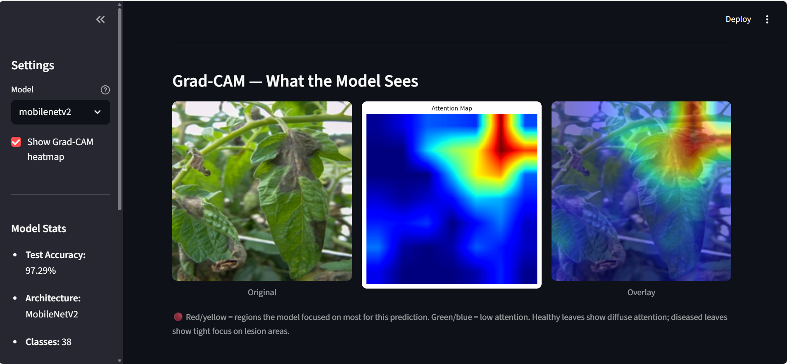

# Plant Disease Detection Using Deep Learning

A deep learning-based plant disease detection system that identifies plant diseases from leaf images using a fine-tuned MobileNetV2 model. The project combines image classification, model explainability, and a Streamlit web application to help users understand the model's predictions.

## 1. Project Overview

Plant diseases can affect crop health and agricultural productivity. Early identification of visible symptoms can help farmers and other users take appropriate action.

This project uses deep learning to classify plant leaf images into different healthy and diseased categories. A web-based application allows users to upload leaf images and view the predicted class, confidence score, and additional visual explanations.

The system uses a **MobileNetV2 model** trained on the PlantVillage dataset and integrates Grad-CAM to visualise image regions that influence the model's predictions.

## 2. Problem Statement

Identifying plant diseases through visual inspection can be challenging, particularly when symptoms are similar across different diseases.

The project aims to develop an image-based classification system that can recognise plant health conditions from leaf images and present the results through an accessible web application.

## 3. Project Objectives

- Develop a deep learning model for plant disease classification.
- Use transfer learning to train a MobileNetV2 model.
- Evaluate the model using appropriate classification metrics.
- Integrate the trained model into a Streamlit application.
- Provide visual explanations of predictions using Grad-CAM.
- Present disease-related information and management suggestions for supported classes.

## 4. Dataset Description

The project uses the **PlantVillage dataset**, a publicly available collection of labelled plant leaf images.

| Dataset characteristic | Description |
|---|---|
| Dataset | PlantVillage |
| Crop species | 14 |
| Classification categories | 38 |
| Image format | RGB |
| Input image dimensions | 224 × 224 |
| Dataset type | Labelled leaf images |

The dataset contains images representing healthy plants and different plant diseases.

**Note:** The dataset contains an imbalance in the number of images available across different classes. Weighted sampling was used during training to help address this imbalance.

## 5. Methodology

The project follows these major stages:

1. **Data preparation:** Load the dataset, organise image classes, and prepare images for model training.
2. **Preprocessing:** Resize images to 224 × 224 pixels, apply augmentation, and normalise image values.
3. **Model development:** Use MobileNetV2 with transfer learning for image classification.
4. **Model training:** Train the classification head and subsequently fine-tune selected layers of the backbone.
5. **Evaluation:** Assess performance using accuracy, precision, recall, and F1-score.
6. **Application integration:** Integrate the trained model into a Streamlit application.
7. **Explainability:** Use Grad-CAM to visualise image regions influencing predictions.

## 6. Model Development and Training

### MobileNetV2

MobileNetV2 is a lightweight convolutional neural network designed for efficient image processing. It uses depthwise separable convolutions and inverted residual blocks to reduce computational requirements.

In this project, transfer learning was used. The pretrained MobileNetV2 network served as the feature extraction backbone, with a custom classification head adapted for the 38 plant disease categories.

### Training Strategy

Training was performed in two phases:

| Phase | Epochs | Training approach |
|---|---:|---|
| Phase 1 | 1–10 | Frozen backbone; train the classification head |
| Phase 2 | 11–20 | Fine-tune the last two backbone blocks and classification head |

**Optimisation settings:**

- Phase 1 learning rate: `1e-3`
- Phase 2 backbone learning rate: `1e-5`
- Phase 2 classification head learning rate: `1e-4`
- Optimiser: Adam
- Class balancing: WeightedRandomSampler

### Data Augmentation

The following transformations were used during training:

- Random resized cropping
- Horizontal flipping
- Vertical flipping
- Rotation up to 15 degrees
- Colour jitter
- ImageNet normalisation

These transformations help the model learn from variations in leaf appearance and image orientation.

## 7. Results and Performance Evaluation

The trained model achieved the following results on the test dataset:

| Evaluation metric | Result |
|---|---:|
| Test Accuracy | 97.29% |
| Macro F1-score | 0.96 |
| Weighted F1-score | 0.97 |
| Number of classes | 38 |
| Test images | 8,146 |

### Performance Metrics

- **Accuracy:** Measures the proportion of correctly classified test images.
- **Precision:** Measures how many images predicted as a particular class actually belong to that class.
- **Recall:** Measures how many actual images of a class were correctly identified.
- **F1-score:** Combines precision and recall into a single metric.

The macro F1-score gives equal importance to each class, while the weighted F1-score accounts for the number of samples in each class.

## 8. Web Application

The trained model is integrated into a web application built using Streamlit.

### Application Features

- **Image Upload:** Upload a plant leaf image for classification.
- **Disease Prediction:** Display the predicted plant condition.
- **Confidence Score:** Display the model's softmax confidence score.
- **Top-5 Predictions:** Show the five highest-scoring predicted classes.
- **Disease Information:** Display available descriptions and management suggestions for supported classes.
- **Severity Information:** Display predefined severity categories for supported classes.
- **Grad-CAM Visualisation:** Display visual explanations of the model's predictions.

### Application Screenshots

Add your application screenshots below.

**Screenshot 1 – Main Application**



**Screenshot 2 – Prediction and Results**



## 9. Model Explainability Using Grad-CAM

Grad-CAM (Gradient-weighted Class Activation Mapping) is an explainability technique used to visualise image regions that contribute to a model's prediction.

In this project, Grad-CAM provides three visual outputs:

1. **Original Image:** The uploaded plant leaf image.
2. **Heatmap:** Highlights regions that contribute to the prediction.
3. **Overlay:** Combines the heatmap with the original image.

These visualisations help users inspect which parts of the leaf image influenced the model's output.

Grad-CAM provides an indication of model attention; it does not prove that the highlighted regions correspond to the biological cause of a disease.

## 10. Technologies Used

| Technology | Purpose |
|---|---|
| Python | Main programming language |
| PyTorch | Deep learning framework |
| MobileNetV2 | Image classification model |
| Torchvision | Image transformations and pretrained models |
| NumPy | Numerical operations |
| Matplotlib | Visualisation |
| Grad-CAM | Model explainability |
| Streamlit | Web application |
| Git and GitHub | Version control and project hosting |

## 11. Project Structure

```text
Plant-Disease-Detection/
│
├── models/
│   ├── class_mapping.json
│   └── mobilenetv2_best.pth
│
├── outputs/
├── src/
├── streamlit_app/
├── venv/
│
├── .gitignore
├── download_data.py
├── LICENSE
├── PlantDisease_Training.ipynb
├── README.md
├── requirements.txt
├── screenshot-app1.png
└── screenshot-app2.png

## 12. Installation and Execution

### Prerequisites

- Python installed on your system.
- Git installed on your system.

### Step 1: Clone the Repository

```bash
git clone https://github.com/Vanshika2907/Plant-Disease-Detection.git
cd Plant-Disease-Detection
```

### Step 2: Install Dependencies

```bash
pip install -r requirements.txt
```

### Step 3: Run the Streamlit Application

Run the following command from the project root directory:

```bash
python -m streamlit run streamlit_app/app.py
```

The application will open in your browser.

## 13. Live Application

The project is deployed using Streamlit Community Cloud.

**Live Demo:** https://plant-disease-detection-bio.streamlit.app/

## 14. Limitations

- The model was trained and evaluated using the PlantVillage dataset. Its performance on real-world field images may differ.
- The model's confidence score is not a guarantee that a prediction is correct.
- Disease descriptions and severity categories are predefined application information, not outputs independently generated by the trained model.
- Detailed disease information is currently available only for supported classes.
- Grad-CAM visualisations indicate influential image regions but do not establish biological causation.
- The application should be treated as an educational and decision-support tool, not a replacement for professional plant disease diagnosis.

## 15. Future Scope

- Expand disease information to cover all 38 classification categories.
- Test the model using real-world images captured under different lighting and environmental conditions.
- Explore additional architectures and compare their performance.
- Improve severity assessment using image-based analysis.
- Explore mobile application integration.
- Investigate model optimisation for deployment on resource-constrained devices.

## 16. Development Approach and Codebase Attribution

This project was developed using an existing open-source repository as its starting framework.

**Original Repository:** [moadil65/Plant-Disease-Detection](https://github.com/moadil65/Plant-Disease-Detection)

The team independently carried out the model training and evaluation process using the PlantVillage dataset and MobileNetV2 architecture. The existing Streamlit application was modified and customised to integrate the trained model and present its predictions, disease-related information, and Grad-CAM visualisations.

The original repository is acknowledged for providing the initial project framework. The modifications and project-specific model development were carried out as part of this university project.
## 17. References

1. Hughes, D. P., & Salathé, M. (2015). *An open access repository of images on plant health to enable the development of mobile disease diagnostics*. arXiv:1511.08060.
2. Sandler, M., et al. (2018). *MobileNetV2: Inverted Residuals and Linear Bottlenecks*. Proceedings of the IEEE Conference on Computer Vision and Pattern Recognition.
3. Selvaraju, R. R., et al. (2017). *Grad-CAM: Visual Explanations from Deep Networks via Gradient-Based Localization*.
4. PyTorch Documentation: https://pytorch.org/docs/
5. Streamlit Documentation: https://docs.streamlit.io/