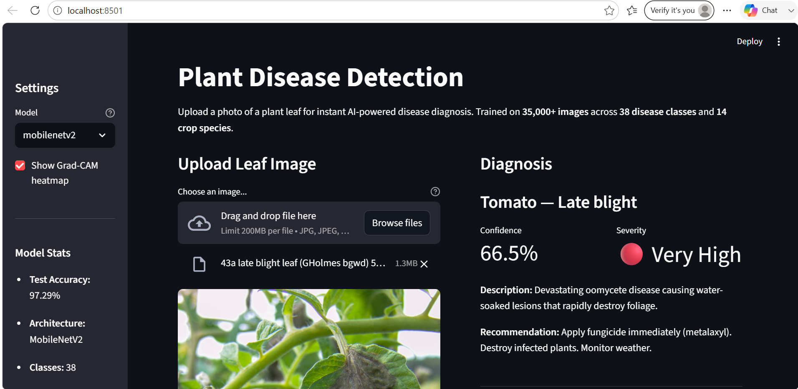
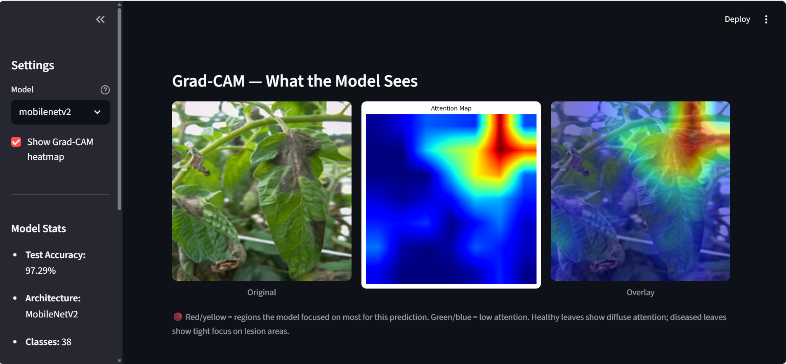

# Plant Disease Detection from Leaf Images Using Deep Learning

A deep learning-based plant health classification system that identifies visible plant conditions from leaf images using four convolutional neural network (CNN) architectures: **MobileNetV2, ResNet50, EfficientNetB0, and DenseNet121**.

The project combines transfer learning, multi-source dataset preparation, comparative model evaluation, Grad-CAM explainability, and an interactive Streamlit web application.

The application supports **five trained model options**: four models trained on a unified 68-class dataset and an original 38-class MobileNetV2 baseline.

## 1. Project Overview

Plant diseases, pest-related damage, and environmental conditions can affect crop health and agricultural productivity. Identifying visible symptoms from leaf images can support preliminary plant-health assessment.

This project uses deep learning to classify plant leaf images into healthy and affected categories. Users can upload leaf images through a Streamlit application, select a trained model, and view predictions, top-five classification results, plant-health information, and Grad-CAM visualizations.

### Available Models

| Model | Classes | Description |
|---|---:|---|
| MobileNetV2 (Baseline) | 38 | Original PlantVillage-based model |
| MobileNetV2 (Expanded) | 68 | Lightweight CNN trained on the combined dataset |
| ResNet50 | 68 | Residual CNN architecture |
| EfficientNetB0 | 68 | Efficiency-focused CNN architecture |
| DenseNet121 | 68 | Densely connected CNN architecture |

The four expanded models were trained and evaluated on the same 68-class classification task.

The system recognizes visual patterns in leaf images. Its predictions should not be treated as confirmed pathogen diagnoses.

## 2. Problem Statement

Identifying plant-health conditions through visual inspection can be challenging because different diseases, pests, and environmental conditions may produce similar symptoms.

Deep learning models can recognize patterns in labelled leaf images, but performance may vary across datasets and image-capture conditions.

This project aims to:

- Develop a multi-class plant-health image classification system.
- Compare four deep learning architectures on a common dataset.
- Evaluate performance using both held-out and separate external images.
- Investigate differences between model performance across evaluation datasets.
- Provide an accessible interface for image classification and visual explanations.

## 3. Project Objectives

- Prepare a unified dataset containing 68 plant-health classes.
- Apply image preprocessing, augmentation, and transfer learning.
- Train MobileNetV2, ResNet50, EfficientNetB0, and DenseNet121.
- Evaluate models using accuracy, precision, recall, and F1-score.
- Compare the four architectures on the same held-out test dataset.
- Evaluate generalization using a separate external image collection.
- Preserve the original 38-class MobileNetV2 baseline.
- Integrate all five model options into the existing Streamlit application.
- Provide top-five predictions and Grad-CAM visualizations.
- Document limitations and potential improvements.

## 4. Dataset Description

The expanded dataset was assembled from four existing image datasets.

| Dataset Source | Images |
|---|---:|
| PlantVillage | 54,284 |
| Groundnut Karnataka | 10,351 |
| MultiCrop | 21,571 |
| Maize | 320 |
| **Total** | **86,526** |

The final dataset contains **86,526 images across 68 classes**.

### Dataset Characteristics

| Characteristic | Description |
|---|---|
| Total images | 86,526 |
| Total classes | 68 |
| Image type | Labelled plant leaf images |
| Input dimensions | 224 × 224 |
| Dataset sources | Four |
| Data partitions | Training, validation, testing |
| Duplicate handling | Exact duplicate checks |
| Classification task | Multi-class classification |

### Final Dataset Split

| Split | Images |
|---|---:|
| Training | 60,027 |
| Validation | 13,693 |
| Testing | 12,806 |
| **Total** | **86,526** |

The dataset preparation process included checking image files, organizing class labels, removing exact duplicate copies, and preparing the final split assignments.

Cross-split SHA-256 checks found no identical image hashes shared between the final training, validation, and test sets. However, this does not rule out near-duplicate images or images of the same plant captured separately.

### Dataset Sources

**PlantVillage:** A labelled collection of plant leaf images representing multiple crops and disease categories.

**Groundnut Karnataka:** Images representing groundnut health conditions, including leaf spot, rust, and nutritional deficiencies.

**MultiCrop:** Images covering conditions affecting Banana, Cauliflower, Chilli, Groundnut, and Radish.

**Maize:** Images representing healthy and affected maize leaves, including viral and fungal disease categories.

The Maize Exserohilum turcicum category was mapped to Northern Leaf Blight.

## 5. Methodology

The project follows these stages:

1. **Data Collection:** Obtain labelled images from the four dataset sources.
2. **Data Cleaning:** Check image validity and identify exact duplicates.
3. **Class Organization:** Prepare a consistent 68-class taxonomy.
4. **Dataset Splitting:** Create training, validation, and test partitions.
5. **Preprocessing:** Apply resizing, cropping, tensor conversion, and normalization.
6. **Data Augmentation:** Apply transformations to training images.
7. **Model Development:** Initialize four pretrained CNN architectures.
8. **Model Training:** Train classification heads and fine-tune selected backbone layers.
9. **Model Evaluation:** Evaluate all four models on the same held-out test split.
10. **External Evaluation:** Test the models on a separate image collection.
11. **Application Integration:** Make the trained models selectable in Streamlit.
12. **Explainability:** Generate Grad-CAM visualizations.

### Image Preprocessing

Training images use transformations including:

- Random resized cropping to 224 × 224
- Horizontal and vertical flipping
- Random rotation
- Color jitter
- Tensor conversion
- ImageNet normalization

Validation and test images use deterministic resizing, center cropping, and ImageNet normalization.

A weighted random sampler is used during training to address differences in class frequency.

## 6. Model Development and Training

Four pretrained CNN architectures were adapted for 68-class plant-health classification.

### MobileNetV2

MobileNetV2 is a lightweight architecture using depthwise separable convolutions, inverted residual blocks, and linear bottlenecks.

It serves as the lightweight comparison model.

### ResNet50

ResNet50 uses residual connections that help train deep neural networks.

It achieved the highest accuracy and macro F1-score in the project's original held-out evaluation.

### EfficientNetB0

EfficientNetB0 uses an architecture designed to balance network depth, width, and input resolution.

It provides an efficiency-oriented comparison with the other models.

### DenseNet121

DenseNet121 uses dense connections between layers to encourage feature reuse and improve information flow.

It provides another architectural approach to image classification.

### Classification Head

The expanded models use a custom classification head with:

- Dropout
- Fully connected layer with 512 units
- ReLU activation
- Additional dropout
- Final fully connected layer with 68 outputs

### Training Configuration

| Parameter | Configuration |
|---|---|
| Training epochs | 20 |
| Batch size | 32 |
| Initial learning rate | 0.001 |
| Fine-tuning learning rate | 0.00001 |
| Optimizer | Adam |
| Loss function | CrossEntropyLoss |
| Learning-rate scheduler | ReduceLROnPlateau |
| Model selection | Best validation accuracy |
| Random seed | 42 |

The initial training phase used a frozen backbone, followed by fine-tuning of selected backbone layers.

The training scripts used similar configurations, although implementation details such as automatic mixed precision and data-loader worker counts differed.

### Training Results

| Model | Best Epoch | Best Validation Accuracy |
|---|---:|---:|
| ResNet50 | 20 | 98.04% |
| DenseNet121 | 19 | 96.01% |
| EfficientNetB0 | 18 | 95.14% |
| MobileNetV2 | 20 | 94.64% |

These values represent validation performance, not final held-out test performance.

## 7. Results and Performance Evaluation

### 7.1 Original 38-Class MobileNetV2 Baseline

The original PlantVillage-based baseline achieved:

| Metric | Result |
|---|---:|
| Test accuracy | 97.29% |
| Macro F1-score | 0.96 |
| Weighted F1-score | 0.97 |
| Classes | 38 |
| Test images | 8,146 |

These results belong to the original 38-class task and are not directly comparable to the four-model 68-class evaluation.

### 7.2 Four-Model Comparison on the Original Held-Out Test Set

All four expanded models were evaluated on the same **12,806-image test set**.

| Model | Accuracy | Macro Precision | Macro Recall | Macro F1 |
|---|---:|---:|---:|---:|
| ResNet50 | 97.85% | 0.9614 | 0.9670 | 0.9572 |
| DenseNet121 | 96.23% | 0.9329 | 0.9487 | 0.9337 |
| EfficientNetB0 | 94.92% | 0.9159 | 0.9327 | 0.9159 |
| MobileNetV2 | 94.59% | 0.9133 | 0.9278 | 0.9109 |

### Correct and Incorrect Predictions

| Model | Correct | Incorrect |
|---|---:|---:|
| ResNet50 | 12,531 | 275 |
| DenseNet121 | 12,323 | 483 |
| EfficientNetB0 | 12,155 | 651 |
| MobileNetV2 | 12,113 | 693 |

**ResNet50 achieved the best results on the original held-out test set**, followed by DenseNet121, EfficientNetB0, and MobileNetV2.

### 7.3 External Dataset Evaluation

A separate evaluation dataset was assembled to investigate how the models performed on images outside the original held-out test collection.

The external dataset contains:

- 90 images
- 30 represented classes
- 20 classes with four images each
- 10 classes with one image each

Only 30 of the 68 model classes were represented.

### External Evaluation Results

| Model | Accuracy | Macro Precision | Macro Recall | Macro F1 |
|---|---:|---:|---:|---:|
| ResNet50 | 30.00% | 0.2427 | 0.2500 | 0.2138 |
| EfficientNetB0 | 24.44% | 0.2356 | 0.2083 | 0.1970 |
| MobileNetV2 | 21.11% | 0.2102 | 0.1833 | 0.1533 |
| DenseNet121 | 20.00% | 0.1746 | 0.1500 | 0.1344 |

### External Correct Predictions

| Model | Correct Predictions |
|---|---:|
| ResNet50 | 27 / 90 |
| EfficientNetB0 | 22 / 90 |
| MobileNetV2 | 19 / 90 |
| DenseNet121 | 18 / 90 |

ResNet50 achieved the highest external accuracy at 30.00%.

However, all four models performed substantially worse on this collection than on the original held-out test set.

### 7.4 Original vs External Evaluation

| Model | Original Test Accuracy | External Accuracy |
|---|---:|---:|
| ResNet50 | 97.85% | 30.00% |
| DenseNet121 | 96.23% | 20.00% |
| EfficientNetB0 | 94.92% | 24.44% |
| MobileNetV2 | 94.59% | 21.11% |

The difference suggests that performance on the original held-out dataset does not necessarily translate to other image collections.

Possible contributors include differences in:

- Lighting and backgrounds
- Camera quality and image resolution
- Leaf positioning and framing
- Disease appearance
- Dataset source characteristics
- Class representation

These are possible explanations, not experimentally established causes.

The external dataset is small and imbalanced, so its results should be interpreted as exploratory evidence rather than a comprehensive field-performance estimate.

### 7.5 Source-Wise Evaluation

The original expanded MobileNetV2 model was also evaluated across the four dataset sources.

| Dataset Source | Test Images | Accuracy |
|---|---:|---:|
| PlantVillage | 8,143 | 95.78% |
| Groundnut Karnataka | 2,451 | 91.92% |
| MultiCrop | 2,164 | 93.02% |
| Maize | 48 | 100.00% |

These are source-wise results for the expanded MobileNetV2 model, not all four architectures.

The Maize result is based on only 48 images and should not be interpreted as evidence of perfect generalization.

Source-wise analysis also identified differences in the classification of Groundnut Early Leaf Spot images between Groundnut Karnataka and MultiCrop.

### 7.6 Evaluation Metrics

**Accuracy:** Proportion of correctly classified images.

**Precision:** Proportion of predictions for a particular class that are correct.

**Recall:** Proportion of actual images belonging to a class that are correctly identified.

**F1-score:** Harmonic mean of precision and recall.

**Macro F1:** Average F1-score across classes, giving equal weight to each class.

**Weighted F1:** Average F1-score weighted by class support.

## 8. Streamlit Web Application

The project includes an interactive web application developed using Streamlit.

The existing application was extended to support all four expanded models while preserving the original baseline.

### Application Features

- **Model Selection:** Choose among five trained models.
- **Image Upload:** Upload a leaf image.
- **Condition Prediction:** Display the predicted plant-health category.
- **Top-5 Predictions:** Display the five highest-scoring classes.
- **Prediction Scores:** View the model's softmax output scores.
- **Plant Information:** Display available symptoms, prevention, and management information.
- **Grad-CAM Visualization:** Inspect influential image regions.
- **Legacy Model Support:** Continue using the original 38-class MobileNetV2 model.

### Available Checkpoints

| Model | Checkpoint |
|---|---|
| MobileNetV2 (38 classes) | `mobilenetv2_best.pth` |
| MobileNetV2 (68 classes) | `mobilenetv2_68_best.pth` |
| ResNet50 (68 classes) | `resnet50_68_best.pth` |
| EfficientNetB0 (68 classes) | `efficientnet_b0_68_best.pth` |
| DenseNet121 (68 classes) | `densenet121_68_best.pth` |

### Application Screenshots

**Screenshot 1 – Main Application**



**Screenshot 2 – Prediction and Results**



These screenshots may show an earlier version of the application. The current four-model interface should be documented using updated screenshots when available.

## 9. Model Explainability Using Grad-CAM

Grad-CAM (Gradient-weighted Class Activation Mapping) is used to visualize image regions that influence a model's prediction.

The application supports Grad-CAM for all five selectable models.

### Grad-CAM Target Layers

| Architecture | Target Layer |
|---|---|
| MobileNetV2 | `model.features[-1]` |
| ResNet50 | `model.layer4[-1]` |
| EfficientNetB0 | `model.features[-1]` |
| DenseNet121 | `model.features.denseblock4` |

The visualization includes:

1. Original uploaded image
2. Grad-CAM heatmap
3. Heatmap overlay on the image

Grad-CAM provides insight into model behavior but does not prove that highlighted regions correspond to the biological cause of a plant condition.

Similarly, softmax prediction scores should not be interpreted as calibrated certainty.

## 10. Technologies Used

| Technology | Purpose |
|---|---|
| Python | Main programming language |
| PyTorch | Deep learning framework |
| torchvision | Pretrained architectures and image transforms |
| MobileNetV2 | Lightweight CNN architecture |
| ResNet50 | Residual CNN architecture |
| EfficientNetB0 | Efficient CNN architecture |
| DenseNet121 | Densely connected CNN architecture |
| NumPy | Numerical operations |
| pandas | Dataset and evaluation analysis |
| Matplotlib | Data visualization |
| scikit-learn | Classification evaluation |
| Grad-CAM | Model explainability |
| Streamlit | Interactive web application |
| Git and GitHub | Version control |
| Git LFS | Large model checkpoint storage |

## 11. Project Structure

```text
Plant-Disease-Detection-main/
│
├── models/
│   ├── class_mapping.json
│   ├── class_mapping_68.json
│   ├── mobilenetv2_best.pth
│   ├── mobilenetv2_68_best.pth
│   ├── resnet50_68_best.pth
│   ├── efficientnet_b0_68_best.pth
│   └── densenet121_68_best.pth
│
├── outputs/
│   ├── mobilenetv2_68_history.json
│   ├── resnet50_68_history.json
│   ├── mobilenetv2_68_classification_report.txt
│   ├── mobilenetv2_68_confusion_matrix.csv
│   ├── source_wise_evaluation/
│   └── groundnut_sigatoka_comparison/
│
├── src/
│   ├── config.py
│   ├── dataset.py
│   ├── expanded_dataset.py
│   ├── model.py
│   ├── four_model_factory.py
│   ├── train.py
│   ├── train_expanded.py
│   ├── train_four_models.py
│   ├── evaluate.py
│   ├── evaluate_expanded.py
│   └── evaluate_by_source.py
│
├── streamlit_app/
│   └── app.py
│
├── .gitattributes
├── .gitignore
├── requirements.txt
├── README.md
├── LICENSE
├── screenshot-app1.png
└── screenshot-app2.png
```

The training datasets and some evaluation artifacts are stored separately and are not included in this repository.

## 12. Installation and Execution

### Prerequisites

- Python
- Git
- Git LFS
- Required Python dependencies

### Step 1: Clone the Repository

```bash
git lfs install

git clone https://github.com/Vanshika2907/Plant-Disease-Detection.git

cd Plant-Disease-Detection
```

### Step 2: Download Model Checkpoints

The model checkpoints are stored in the repository, with the three newer checkpoints tracked using Git LFS.

If necessary, run:

```bash
git lfs pull
```

### Step 3: Install Dependencies

```bash
pip install -r requirements.txt
```

### Step 4: Run the Streamlit Application

```bash
python -m streamlit run streamlit_app/app.py
```

The application will open in your browser.

The corresponding model checkpoints and class mapping files must be present in the `models/` directory.

The original training datasets are not included in the repository and must be obtained separately to reproduce training.

## 13. Live Application

An earlier version of the project was deployed using Streamlit Community Cloud.

**Live Demo:** https://plant-disease-detection-bio.streamlit.app/

The current deployment status of the updated four-model application has not been verified.

The repository contains the updated application code and model checkpoints, but successful GitHub updates do not automatically establish that all models work on the hosted deployment.

## 14. Limitations

- The training dataset combines images from different sources with different visual characteristics.
- The original test images come from sources also represented in training.
- Exact hash checks do not rule out visually similar images across splits.
- The external dataset contains only 90 images across 30 classes.
- External evaluation accuracy was substantially lower than held-out test accuracy.
- Some class labels may require further expert verification.
- The models classify among known categories and do not reliably identify unknown diseases.
- Softmax scores are not calibrated confidence estimates.
- Grad-CAM does not establish biological causation.
- The system is not validated as a professional agricultural diagnostic tool.

The application is intended for educational use and preliminary plant-health assessment.

## 15. Future Scope

- Collect a larger, balanced external evaluation dataset.
- Improve generalization across real-world imaging conditions.
- Investigate domain adaptation techniques.
- Analyze errors across crops and disease categories.
- Improve underrepresented classes.
- Evaluate model calibration and uncertainty.
- Explore unknown-condition detection.
- Optimize inference for lower-resource devices.
- Expand and validate the plant-health knowledge base.
- Investigate mobile application integration.

## 16. Development Approach and Codebase Attribution

This project was developed using an existing open-source repository as its starting framework.

**Original Repository:** https://github.com/moadil65/Plant-Disease-Detection

The original repository provided the initial project framework and application structure.

The team extended the project through:

- Dataset preparation and cleaning
- Expansion to 68 plant-health classes
- Training and evaluation of four CNN architectures
- Source-wise analysis
- Separate external dataset evaluation
- Integration of additional trained models
- Streamlit application improvements
- Grad-CAM support for multiple architectures
- Plant-health knowledge-base updates

The original repository is acknowledged for its contribution to the initial framework.

## 17. References

1. Hughes, D. P., & Salathé, M. (2015). *An open access repository of images on plant health to enable the development of mobile disease diagnostics*. arXiv:1511.08060.
2. Mohanty, S. P., Hughes, D. P., & Salathé, M. (2016). *Using Deep Learning for Image-Based Plant Disease Detection*. Frontiers in Plant Science.
3. Sandler, M., et al. (2018). *MobileNetV2: Inverted Residuals and Linear Bottlenecks*. CVPR.
4. He, K., et al. (2016). *Deep Residual Learning for Image Recognition*. CVPR.
5. Tan, M., & Le, Q. V. (2019). *EfficientNet: Rethinking Model Scaling for Convolutional Neural Networks*. ICML.
6. Huang, G., et al. (2017). *Densely Connected Convolutional Networks*. CVPR.
7. Selvaraju, R. R., et al. (2017). *Grad-CAM: Visual Explanations from Deep Networks via Gradient-Based Localization*. ICCV.
8. PyTorch Documentation: https://pytorch.org/docs/
9. Streamlit Documentation: https://docs.streamlit.io/
10. scikit-learn Documentation: https://scikit-learn.org/stable/
11. Original project repository: https://github.com/moadil65/Plant-Disease-Detection
